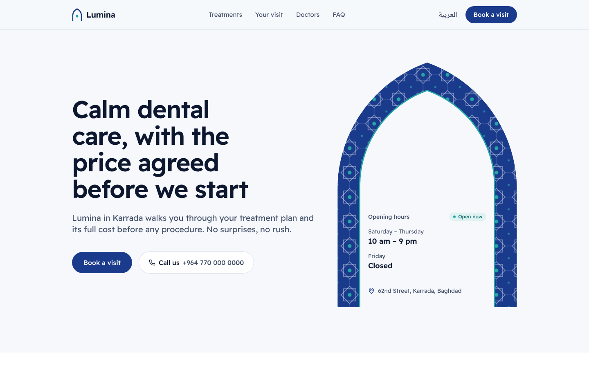
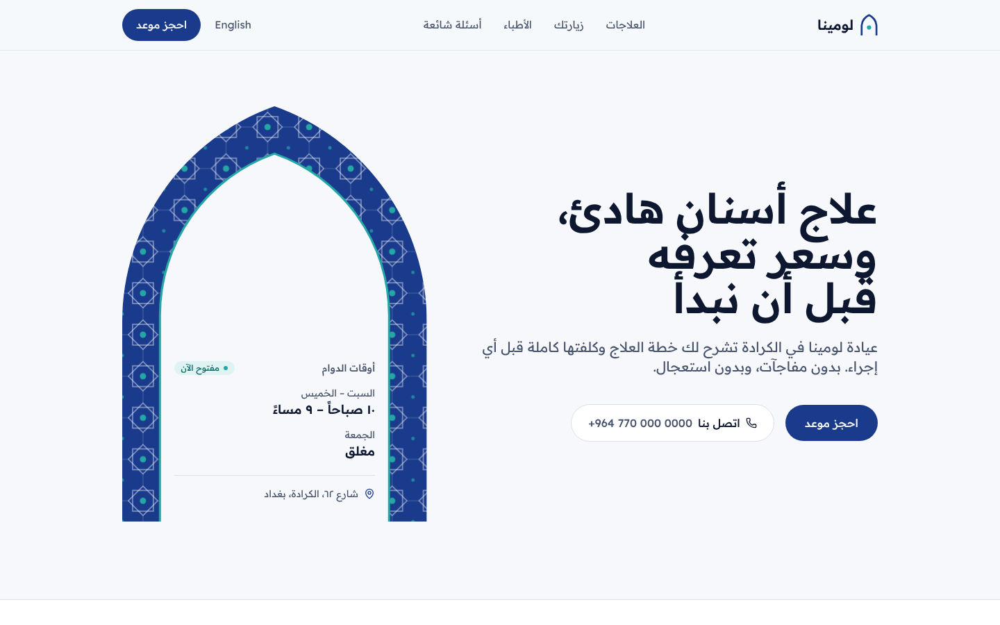
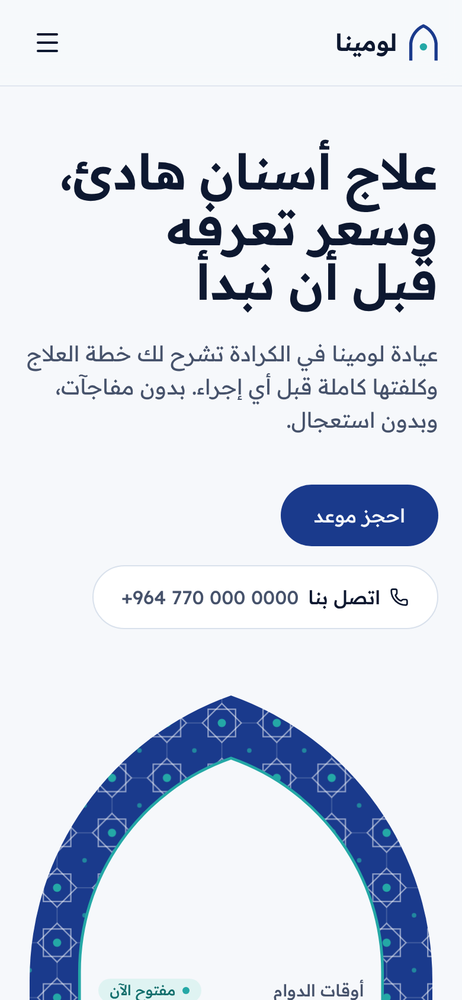
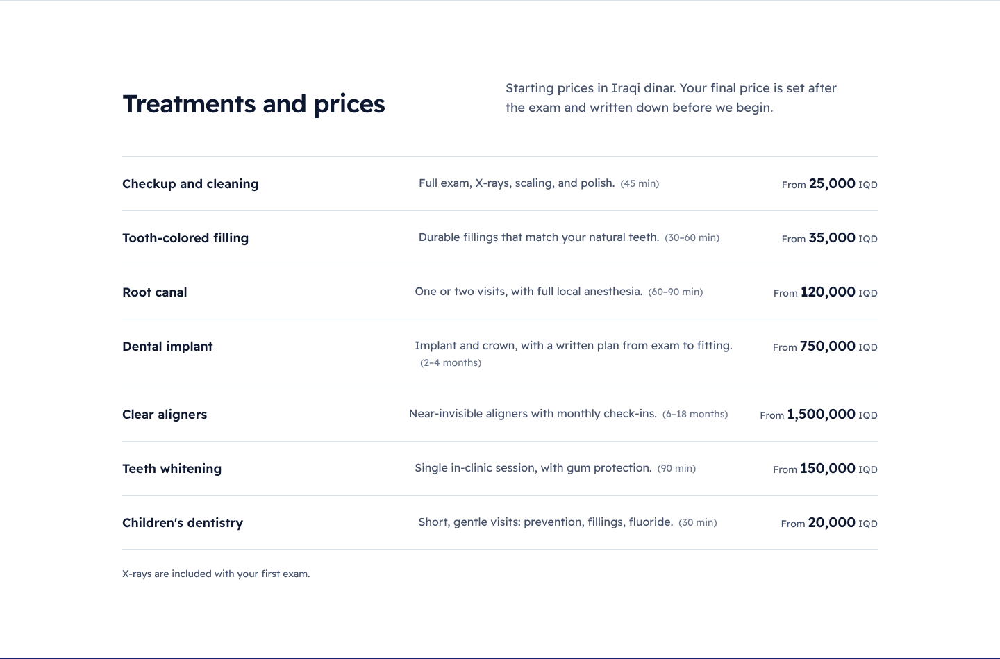
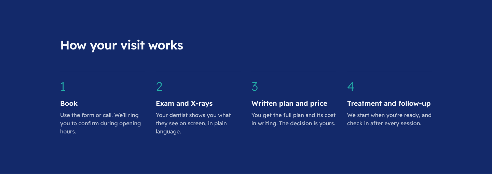
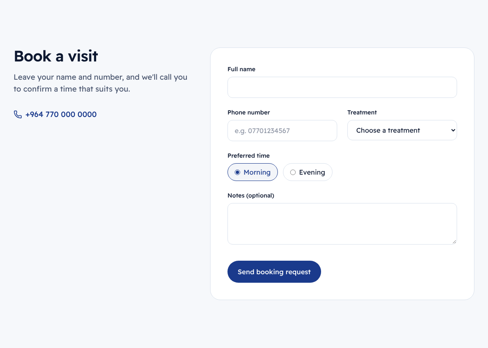

<div align="center">

# 🦷 Lumina Dental

**A bilingual (Arabic / English) website concept for a dental clinic in Baghdad, built with Next.js, TypeScript, and Tailwind CSS.**

[](https://mustafacoder365.github.io/lumina-dental-website/)


<br>



</div>

> **Concept project.** Lumina is a fictional clinic. The names, prices, and contact details are sample content.

---

## ✨ Highlights

- 🌍 **Full Arabic and English** — separate routes (`/ar`, `/en`), right-to-left layout for Arabic, and automatic language pick on first visit
- 🕌 **Distinctive identity** — palette and hero pattern drawn from Baghdad's glazed *kashi* tilework, instead of the usual clinic template
- 🟢 **Live "open now" status** — calculated in Baghdad time from the clinic's opening hours
- 💰 **Transparent pricing** — treatments listed with starting prices in Iraqi dinar
- 📝 **Booking form** — validation for Iraqi mobile numbers, accessible error messages, and a clear confirmation state
- ♿ **Accessible** — semantic landmarks, skip link, keyboard focus styles, and reduced-motion support
- 📱 **Responsive** — designed for phones first, where most patients will book
- ⚡ **Static export** — no server needed, deployed to GitHub Pages with GitHub Actions

## 📸 Screenshots

| Arabic (RTL) | Mobile |
|---|---|
|  |  |

| Treatments and prices |
|---|
|  |

| Visit process |
|---|
|  |

| Booking form |
|---|
|  |

## 🧭 Page sections

| Section | What it does |
|---|---|
| **Hero** | Clear promise, booking and call buttons, live opening hours |
| **Treatments** | Seven treatments with short descriptions, durations, and starting prices |
| **Your visit** | The four steps from booking to follow-up |
| **Doctors** | Three specialists and what each one treats |
| **FAQ** | Answers to the questions patients ask most |
| **Booking** | Validated request form with a confirmation state |

## 🛠️ Tech Stack

| Area | Tools |
|---|---|
| **Framework** | [Next.js 16](https://nextjs.org/) (App Router, static export) |
| **Language** | TypeScript |
| **Styling** | [Tailwind CSS 4](https://tailwindcss.com/) with design tokens |
| **Typography** | [Readex Pro](https://fonts.google.com/specimen/Readex+Pro) — one family for Arabic and Latin |
| **Icons** | [Lucide](https://lucide.dev/) |
| **Deployment** | GitHub Pages via GitHub Actions |

## 📂 Project Structure

```
app/
├── (root)/        # Language picker for "/"
└── [lang]/        # Arabic and English pages (layout sets lang + dir)
components/        # Header, tile arch, hours card, booking form, logo
lib/content.ts     # All copy, in Arabic and English
public/            # Favicon
```

## 🚀 Getting Started

```bash
git clone https://github.com/MustafaCoder365/lumina-dental-website.git
cd lumina-dental-website
npm install
npm run dev
```

Open http://localhost:3000/en or http://localhost:3000/ar.

### Build

```bash
npm run build   # static site in ./out
```

Pushing to `main` deploys automatically through `.github/workflows/deploy.yml`.

## 👤 Author

**Mustafa Shakir** — Frontend Software Developer

[](https://github.com/MustafaCoder365)
[](https://www.linkedin.com/in/mustafa-shakir-840374330)
[](mailto:mustafa1997670@gmail.com)
